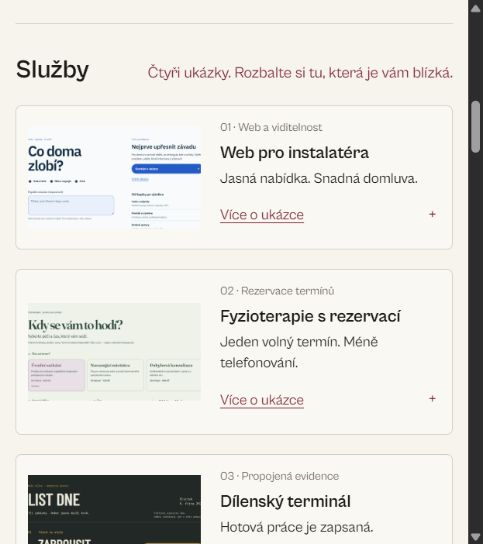
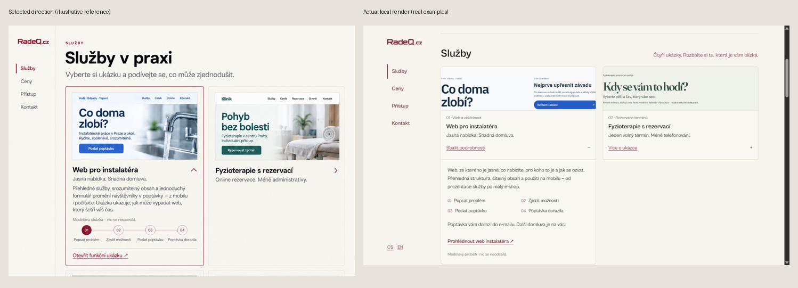

# Design QA — RadeQ studio index

## Aktuální doplnění — škálování, 28. 10. 2026

**PASS po jedné cílené opravě.** Předchozí kontrola globálního přetékání přehlédla ořez miniatur a lokální přetečení nízké levé lišty. Tyto závěry nahrazuje nezávislé ověření v `docs/design/2026-10-28-responsive/verification.md` a `verification.json`; původní důkazy níže zůstávají historické.

Builder upravil pouze dva styly. Kritik přijal plán a implementaci; ověřovatel prověřil skutečný panel498×562, CZ/EN320,390,601,768,900,1024,1099,1100,1280px, otevřené karty a volitelné části formuláře, menu/klávesnici, právní shell, návrat z ukázky a ekvivalentní reflow. Všech osm obrázků se vejde s celým obsahem. Dlaždice při498px mají zhruba149–171px místo původních336px. Na užším mobilu se obrázek přesune nad text; obsah přirozeně roste svisle.

V nízkém okně1280×400 EN odhalil ověřovatel vodorovné zalomení levé lišty a skryté jazyky. Po cílené opravě a re-review: rail clientWidth113px = scrollWidth113px; přebytečná výška440px se posouvá svisle v400px okně. Tab na jazyk posune lištu o40px a celý44px cíl je vidět. Cíleně zopakovány také1100px, vysoký desktop CZ/EN a498px mobilní menu. Žádný zbývající blokující nález v tomto rozsahu.

Finální `build-1793216670490`:24compiled testů PASS, Astro0chyb/0varování/6hints, shoda všech zdrojů a výstupů v `parent-checks.json`. Nativní125/200%zoom nebyl API dostupný;1024/640px reflow je náhradní kontrola, nikoli důkaz nativního zoomu. Statický localhost nadále nemá API a produkční Turnstile zde hlásí110200; žádná poptávka ani měření nebyly odeslány. Pouze místní náhled, produkce se neměnila.

## Historický výsledek prvního návrhu

2026-10-28. **PASS pro místní vybraný směr**, s níže uvedenými omezeními důkazů. Produkce se neměnila.

Autorita: vlastník vybral levé menu a patku třetího konceptu, zmenšené služby jako dlaždice s dalšími ukázkami a povídáním po rozbalení. Právní sazba má mít odstavce a kratší řádky, nikoli nové patkové písmo. Schválený směr byl před implementací upřesněn v `refined-index.png`.

## Kombinované vizuální porovnání

V jednom obrazu porovnány odpovídající služby s první otevřenou a druhou zavřenou dlaždicí. Zachována levá navigace, krémová/vínová, originální logo a bezpatková typografie. Záměrně menší písmo/rozestupy a původní skutečné modelové weby namísto ilustračních fotografií generovaného konceptu. Zavřený soused se nevytahuje na výšku otevřené karty. Patka používá stejné tři skupiny a skutečné právní/kontaktní odkazy. Nativní ovládání má44px cíle, proto patka není stejně nízká jako ilustrace.

## Nalezeno a opraveno

| Priorita | Zjištění | Oprava / důkaz |
|---|---|---|
| P2 | Původní úzké výřezy jen obřího titulku nevystihovaly ukázku. | Nové širší snímky skutečných CZ/EN ukázek, bez dvojitého vnitřního rámečku. |
| P2 | První realizace měla389px dlaždice a dlouhý seznam kroků dědil globální padding. | Dlaždice280px, otevřená594px; kroky desktop2×2 bez přebytečného paddingu. `08-services-after.png`, `09-services-open-after.png`. |
| P2 | E-shop byl dříve sekundární odkaz s návratem na webovou službu. | Čtvrtá samostatná dlaždice, návrat `#sluzba-eshop`; skutečný EN proklik a návrat otevírá a posune správnou kartu. |

Žádný zbývající P0/P1/P2 problém ve zkontrolovaném vizuálním rozsahu. Toto není právní certifikace ani audit všech starších podstránek.

## Skutečné vykreslení a chování

- 1280×720: všechny čtyři zavřené dlaždice jsou v jednom pohledu, každá279,85px; sekce718,9px. Otevřený první detail594,45px, přímý proklik dostupný v prvním pohledu. Karty se standardně načítají zavřené, známý hash otevírá jen cílovou.
- Formulář desktop524,2px proti původním876px; jméno/e-mail vedle sebe, zachovány štítky, textarea, volitelný rozpočet/termín, status, Turnstile a právní odkazy. Mobil390px základ652,6px, s doplňujícími detaily822,2px; přirozený růst, žádný vnitřní scroll/clipping.
- 390×844 a320×740, včetně EN otevřeného e-shopu a právní stránky: žádné horizontální přetékání. `13-mobile-menu-after.png` až `19-en-open-mobile-final.png`. Nativní menu i dlaždice otevřeny Enterem, přechod na službu menu zavře.
- Šířky640,1099,1100,1280px: bez přetečení. Do1099px mobilní menu, od1100px levá lišta, skrytá varianta není v klávesové navigaci.
- Podmínky/soukromí: čtecí sloupec651,26px/64ch, text16px/27,2px, sekce bez dřívějšího96px paddingu. Obsah má funkční kotvy. Compiled test ověřuje přesný text a pořadí kompletních odkazů všech čtyř právních stránek.
- Patka: funkční právní/tool odkazy a nastavení cookies. Dialog otevřen a volitelné měření odmítnuto. Původní backend, souhlasy, měření, ceny a emailový renderer zachovány.

## Kontroly a hranice důkazů

`verification.json` obsahuje finální manifest a ověřené hashe všech zdrojů/artefaktů i nezměněného backendu.24compiled testů, Astro0chyb/0varování. První plný běh141unitPASS; závěrečný souběh fixture buildů vyvolal timeout ve třech testových souborech, které pak všechny prošly postupně24/24. Šest cílených testů právních stránek a faviconPASS. Záznamy zůstávají zachované včetně timeoutů. Source review přijato; poslední změny po review jsou širší skutečné obrázky, úspornější CSS a aktualizované supersedované očekávání testů.

Root4395 je statický místní náhled bez API; nic se neodesílalo. Turnstile upozorňuje110200 (localhost není povolená produkční doména), nebyl řešen CAPTCHA ani měněn bezpečnostní klíč. Ostatní nová aplikační chyba v prohlížeči nezjištěna. Favicon má životní cyklus/rušení/cache prověřené testy, IAB však neukazuje nativní lištu karet a neprokazuje animaci v konkrétním Chrome/Edge.640px reflow je náhradní kontrola úzkého rozvržení, nikoli důkaz nativního200%zoomu. Bez JavaScriptu je použitelnost menu/dlaždic založena na nativním HTML, samostatný běh s vypnutým JS nebyl proveden. Do produkce nebylo publikováno.
